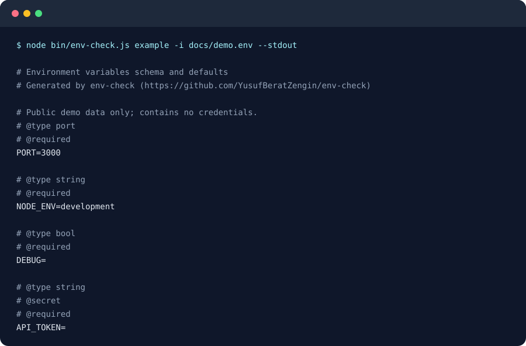

# env-check

[](https://github.com/YusufBeratZengin/env-check/actions/workflows/ci.yml)
[](LICENSE)
[](package.json)
[](https://www.npmjs.com/package/env-check)

`.env` dosyalarını şemaya göre doğrulayın, eksik yapılandırmayı yakalayın ve terminal raporlarında gizli değerleri maskeleyin.

[English](README.md) · [Katkıda bulunma](CONTRIBUTING.md) · [Değişiklik günlüğü](CHANGELOG.md)



## Neden env-check?

- **Çalışma zamanında harici bağımlılık yok.** CLI ve kütüphane, Node.js standart kütüphanesiyle çalışır.
- **Şema, yapılandırmanızın yanında.** `.env.example` dosyasına yorumlarla tip, varsayılan değer ve desen ekleyin veya desteklenen JSON Schema alanlarını kullanın.
- **CI için işe yarayan geri bildirim.** Unutulmuş yer tutucuları, yinelenen anahtarları ve Git'in izlediği env dosyalarını yakalayın; değerleri göstermeden anahtar kümelerini karşılaştırın.

## Hızlı başlangıç

Node.js 20 veya üzeri gerekir:

```bash
git clone https://github.com/YusufBeratZengin/env-check.git
cd env-check
node bin/env-check.js example -i docs/demo.env --stdout
node bin/env-check.js check -e docs/demo.env -s docs/env.schema.json --no-system --no-git
```

Her iki CLI komutu da paket kurmadan çalışır. İlki yukarıdaki demoyu üretir; ikincisi `0` koduyla çıkar ve `4/4 variables verified` sonucunu verir. Örnek dosyada yalnızca herkese açık demo verileri bulunur.

Bu adımlar npm yayınına ihtiyaç duymadan deponun kaynak kodunu çalıştırır. npm rozeti kayıt sisteminin durumunu gösterir; paket yayımlanmadan önce sürüm bilgisi görünmeyebilir. Bu paket kurulduğunda aynı komutlar `env-check` çalıştırılabilir dosyasıyla kullanılabilir.

## Kullanım örnekleri

```bash
# Kendi projenizde .env dosyasını .env.example ile denetleyin
node bin/env-check.js check

# Dosyaları sırayla birleştirin; sonraki dosyanın değerleri önceliklidir
node bin/env-check.js check -e .env -e .env.local -x .env.example --no-system

# Doğrulama hatalarının yanı sıra uyarılarda da başarısız olun
node bin/env-check.js check --strict --no-system

# Açık değerleri gösterin; gizli alanlar terminalde maskelenmeye devam eder
node bin/env-check.js check --no-mask

# Şablon üretin; paylaşmadan önce içeriğini gözden geçirin
node bin/env-check.js example -i docs/demo.env --stdout

# Anahtarları ve dolu/boş durumlarını karşılaştırın; farklı anahtarlarda çıkış kodu 1 olur
node bin/env-check.js diff test/fixtures/a.env test/fixtures/b.env

node bin/env-check.js --help
```

`diff`, değerlerin eşitliğini değil, anahtarları ve değerlerin dolu olup olmadığını karşılaştırır. Anahtarlar aynıysa değerler farklı olsa da çıkış kodu `0` olur.

### Kütüphane API'si

```javascript
import { validateEnv } from 'env-check';

const { config } = validateEnv({
  example: '.env.example',
  files: ['.env', '.env.local'],
  system: false,
  throwOnError: true
});

// Portlar sayıya, boolean alanlar boolean değerine,
// süreler milisaniyeye dönüşür. config nesnesini gizli tutun.
```

Kaynak kodu doğrudan kullanıyorsanız `./src/index.js` yolundan içe aktarın. API ayrıca `loadEnv`, `loadSchema`, `parseDotenv`, `Schema`, karşılaştırma yardımcıları ve doğrulama hatalarını dışa aktarır; bkz. [src/index.js](src/index.js).

## Yapılandırma

### Açıklamalı `.env.example`

Direktifleri değişkenin hemen üstüne, arada boş satır bırakmadan yazın:

```dotenv
# HTTP portu
# @type port
# @default 3000
PORT=3000

# @type enum(development, staging, production)
# @default development
NODE_ENV=development

# @type string
# @required
# @secret
API_TOKEN=

# @type duration
# @default 15m
CACHE_TTL=15m

# @pattern /^[a-z-]+$/
SERVICE_NAME=demo-service
```

| Direktif | Davranış |
| --- | --- |
| `@type` | `string`, `int`/`integer`, `port`, `bool`/`boolean`, `url`, `email`, `duration`, `enum(a,b)` |
| `@required` | Varsayılan değer uygulandıktan sonra eksik veya boş değeri reddeder |
| `@default değer` | Eksik veya boş giriş için kullanılacak değer |
| `@secret` | İnsan tarafından okunabilen doğrulama çıktısında alanı maskeler |
| `@pattern /regex/` | Değeri düzenli ifadeyle denetler |

Örnek dosyadaki boş olmayan ve yer tutucu sayılmayan değerler, `@default` ile başka bir değer verilmedikçe varsayılan kabul edilir. Herhangi bir alanda `@required` varsa yalnızca açıkça zorunlu işaretlenen alanlar zorunludur. Hiç yoksa varsayılan değeri bulunmayan alanlar zorunludur. 0.1.0 sürümünde `@optional` tek başına bu son kuralı değiştirmez.

Tipler; güvenli tam sayıları, 1–65535 arasındaki portları, büyük/küçük harfe duyarsız `true/false`, `1/0`, `yes/no` boolean değerlerini, protokol içeren URL'leri ve yaygın e-posta biçimlerini destekler. Süreler milisaniye veya `500ms`, `10s`, `15m`, `2h`, `1d`, `1w`, `1y`, `1h 30m` gibi ifadelerle verilebilir.

### JSON şeması

`-s env.schema.json` seçeneğini kullanın. Desteklenen alanlar: `properties`, `required`; her özellik için `type`, `enum`, `default`, `description`, `pattern`, `format` (`uri`, `url`, `email`) ve `secret`/`x-secret`. Çalıştırılabilir [demo şemasına](docs/env.schema.json) bakabilirsiniz.

Bu destek, düz ortam değişkenleri için bir şema uyarlamasıdır; JSON Schema standardının tamamını doğrulamaz. `$ref`, `allOf`, `minimum`, `maximum`, iç içe nesneler ve diziler denetlenmez. Port aralığını denetlemek için örnek şemada `@type port` kullanın.

### Yükleme ve CLI seçenekleri

| Seçenek | Varsayılan / davranış |
| --- | --- |
| `-e, --env` | `.env`; birden fazla dosya için tekrarlanabilir |
| `-x, --example` | `.env.example` |
| `-s, --schema` | Örnek dosya yerine JSON şeması |
| `--no-system` | Normalde dosyalardan öncelikli olan `process.env` birleştirmesini kapatır |
| `--expand` | `$VAR`, `${VAR}` ve `${VAR:-yedek}` ifadelerini genişletir |
| `--strict` | Bilinmeyen anahtar, yinelenen anahtar ve Git izleme uyarılarını hataya çevirir |
| `--no-git` | Git izleme denetimini atlar |
| `--quiet` | Başarılı çıktıyı gizler; uyarı ve hatalar kalır |
| `--no-mask` | Terminalde gizli olmayan değerleri açık gösterir |
| `--json` | Makine tarafından işlenebilir sonuç; **`check`, gizli alanlar dahil ham config değerlerini içerir** |

Kütüphane aynı seçeneklerin karşılıklarını (`files`, `example`, `schemaFile`, `system`, `expand`, `strict`, `checkGit`) ve ayrıca `schema`, `env`, `cwd`, `throwOnError` seçeneklerini kabul eder. Sonraki dosya öncekinin, sistem ortamı ise dosyaların değerlerini geçersiz kılar. Bulunamayan env dosyaları atlanır; şema dosyasının bulunamaması hatadır.

| Çıkış kodu | Anlamı |
| --- | --- |
| `0` | Doğrulama başarılı, şablon üretildi veya karşılaştırılan anahtarlar aynı |
| `1` | Doğrulama başarısız, katı mod uyarısı var veya anahtarlar farklı |
| `2` | Yapılandırma, dosya veya komut hatası |

## Sık sorulanlar / Sınırlar

**JSON çıktısını CI loglarına yazabilir miyim?** `check --json` çıktısını hassas veri olarak ele alın: `config` doğrulanmış değerleri ham haliyle içerir. Kütüphanenin döndürdüğü `config` için de aynı durum geçerlidir. Paylaşılan loglarda normal terminal raporlarını kullanın; gizli alanlar `--no-mask` açıkken bile `[SECRET len=N] ********` biçiminde gösterilir.

**Gizli alanlar nasıl belirlenir?** `@secret` veya JSON'da `secret: true` kullanın. Adında `TOKEN`, `PASSWORD`, `API_KEY` gibi desenler bulunan alanlar da gizli kabul edilir. Hassas URL'leri ve alışılmadık adları açıkça işaretleyin. Maskeleme bir sır tarayıcısı değildir; değer uzunluğu görünür kalır. Üretilen şablonları, özellikle korunan `HOST`, `NODE_ENV` ve port varsayılanlarını paylaşmadan önce inceleyin.

**Katı mod neden kabuk değişkenlerim için uyarı veriyor?** Varsayılan olarak `process.env` birleştirilir ve şemada olmayan anahtarlar uyarı üretir. Yalnızca dosyaları doğrulamak için `--no-system` kullanın. Genişletme yine de `process.env` içinden değer çözebilir; bağımsız örnekler için `--expand` seçeneğini kapalı bırakın.

**Tüm dotenv biçimleri ve JSON Schema anahtarları destekleniyor mu?** Hayır. Ayrıştırıcı tırnakları, kaçış karakterlerini, çok satırlı değerleri, yorumları ve `export` önekini destekler; hatalı satırları ve kapanmamış tırnakları ise tolere eder. JSON Schema desteği listelenen alanlarla sınırlıdır. Yinelenen anahtar uyarıları dosya içindeki tekrarlara yöneliktir; dosyalar arasındaki bilinçli geçersiz kılmalara değil.

## Katkıda bulunma

Bkz. [CONTRIBUTING.md](CONTRIBUTING.md). Geliştirme kontrolleri:

```bash
npm ci --ignore-scripts
npm test
npm run lint
npm run typecheck
npm run demo
```

Testler, CLI işleyicileri dahil `src/` için yerleşik kapsam raporunu yazdırır ve en az **%85 satır kapsamı** şartını uygular. CI, Linux, Windows ve macOS üzerinde Node.js 20 ve 22 ile çalışır. Güvenlik açıkları için [SECURITY.md](SECURITY.md) yönergelerini izleyin.

## Lisans

[MIT](LICENSE).
